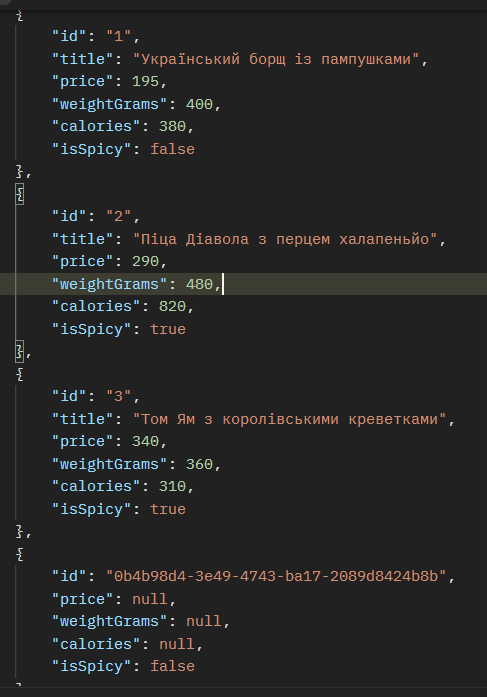
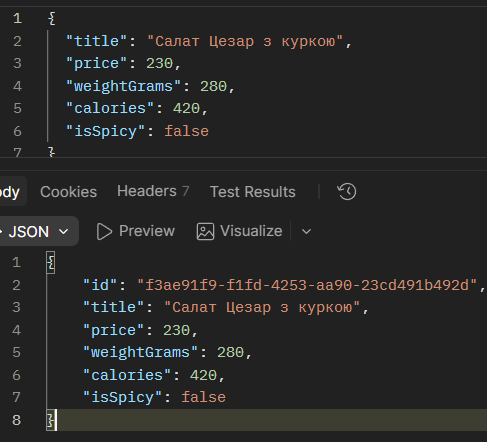
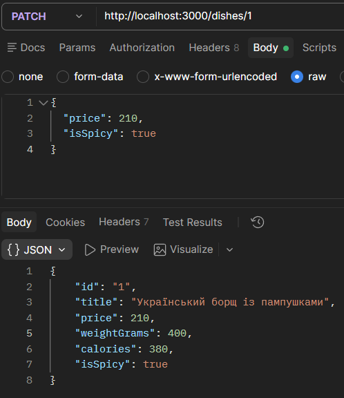
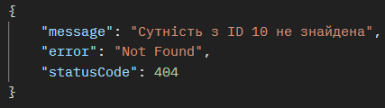
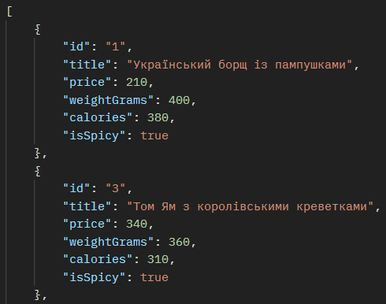

# Бекенд інтернет-магазину / сервісу доставки їжі (NestJS REST API)

> **Практична робота**: Розробка стандартизованого REST API контролера на базі NestJS з використанням DTO, Dependency Injection, In-Memory сервісу та обробки HTTP-виключень.  
> **Варіант №4**: Доставка їжі та ресторанів — ресурс `/dishes`.

---

## 1. Опис проєкту

Проєкт реалізує повнофункціональний REST API для управління асортиментом страв служби доставки їжі та ресторанів. Архітектура застосунку побудована з дотриманням принципів високої модульності, слабкої зв'язності (Loose Coupling) та інверсії керування (IoC) фреймворку NestJS.

### Специфікація сутності `Dish` (Варіант 4)

| Поле | Тип | Обов'язкове | Опис |
| :--- | :--- | :---: | :--- |
| `id` | `string` | Так (системне) | Унікальний ідентифікатор запису (UUID) |
| `title` | `string` | Так | Назва страви (наприклад, *"Український борщ із пампушками"*) |
| `price` | `number` | Так | Вартість страви у гривнях |
| `weightGrams` | `number` | Так | Вага порції у грамах |
| `calories` | `number` | Так | Енергетична цінність у кілокалоріях (ккал) |
| `isSpicy` | `boolean` | Так | Прапорець гостроти страви |

---

## 2. Архітектура застосунку та структура каталогів

Проєкт організовано згідно зі стандартами NestJS CLI:

```text
online-store/
├── src/
│   ├── dishes/
│   │   ├── dto/
│   │   │   ├── create-dish.dto.ts      # DTO для створення страви (обов'язкові поля)
│   │   │   └── update-dish.dto.ts      # DTO для оновлення страви (опціональні поля)
│   │   ├── entities/
│   │   │   └── dish.entity.ts          # Клас моделі сутності Dish
│   │   ├── dishes.controller.ts        # Контролер: маршрутизація, декоратори, статуси
│   │   ├── dishes.controller.spec.ts   # Модульні тести контролера
│   │   ├── dishes.service.ts           # Сервіс: In-Memory сховище та бізнес-логіка
│   │   ├── dishes.service.spec.ts      # Модульні тести сервісу
│   │   └── dishes.module.ts            # Окремий ресурсний модуль DishesModule
│   ├── app.controller.ts               # Кореневий контролер
│   ├── app.module.ts                   # Кореневий модуль AppModule
│   ├── app.service.ts                  # Кореневий сервіс
│   └── main.ts                         # Точка входу в застосунок
├── test/
│   ├── app.e2e-spec.ts                 # Базовий e2e тест
│   └── dishes.e2e-spec.ts              # Повні E2E тести CRUD для /dishes
├── package.json
└── tsconfig.json
```

### Ключові компоненти

1. **DTO (Data Transfer Objects)**:
   - `CreateDishDto`: контракт для створення сутності з полями `title`, `price`, `weightGrams`, `calories`, `isSpicy`.
   - `UpdateDishDto`: контракт для оновлення з тими самими опціональними полями.
2. **In-Memory Service (`DishesService`)**:
   - Містить приватне сховище `private items: Dish[] = [...]` з 3 початковими записами.
   - Підтримує query-фільтрацію у методі `findAll()` (пошук за назвою, фільтрація за ознакою гостроти `isSpicy`, фільтрація за максимальною ціною `maxPrice`).
   - Метод `findOne(id)` викидає стандартне HTTP-виключення `NotFoundException(\`Сутність з ID ${id} не знайдена\`)`, якщо запис відсутній.
   - Метод `create(dto)` генерує унікальний UUID через `randomUUID()` та додає об'єкт у сховище.
   - Методи `update(id, dto)` та `remove(id)` знаходять елемент або викидають `NotFoundException`.
3. **Контролер (`DishesController`)**:
   - Отримує `DishesService` через параметризований конструктор (Constructor Injection).
   - Явно встановлює статус **201 Created** для `POST /dishes` за допомогою декоратора `@HttpCode(HttpStatus.CREATED)`.
   - Явно встановлює статус **204 No Content** для `DELETE /dishes/:id` за допомогою декоратора `@HttpCode(HttpStatus.NO_CONTENT)`.

---

## 3. Таблиця маршрутів REST API

| HTTP Метод | Маршрут | Опис | Тіло запиту / Query | HTTP Статус |
| :--- | :--- | :--- | :--- | :---: |
| `GET` | `/dishes` | Отримання списку всіх страв або фільтрація | `?search=...`<br>`?isSpicy=true\|false`<br>`?maxPrice=...` | `200 OK` |
| `GET` | `/dishes/:id` | Отримання страви за ідентифікатором | Шлях: `:id` | `200 OK` / `404 Not Found` |
| `POST` | `/dishes` | Створення нової страви | `CreateDishDto` (JSON) | `201 Created` |
| `PATCH` | `/dishes/:id` | Часткове оновлення полів страви | `UpdateDishDto` (JSON) | `200 OK` / `404 Not Found` |
| `PUT` | `/dishes/:id` | Повне/часткове оновлення страви | `UpdateDishDto` (JSON) | `200 OK` / `404 Not Found` |
| `DELETE` | `/dishes/:id` | Видалення страви за ідентифікатором | Шлях: `:id` | `204 No Content` / `404 Not Found` |

---

## 4. Інструкція із встановлення та запуску

### Вимоги
- Node.js (версія 18 або новіша)
- npm

### 1. Встановлення залежностей
```bash
npm install
```

### 2. Запуск у режимі розробки (Watch mode)
```bash
npm run start:dev
```
Сервер буде доступний за адресою: `http://localhost:3000`.

### 3. Збірка проєкту (Production build)
```bash
npm run build
```

### 4. Запуск скомпільованого коду
```bash
npm run start:prod
```

---

## 7. Приклади HTTP-запитів та відповідей API

### 1. Отримання всіх страв (`GET /dishes` — 200 OK)

**Запит:**
```http
GET /dishes HTTP/1.1
Host: localhost:3000
```

**Відповідь (`200 OK`):**
```json
[
  {
    "id": "1",
    "title": "Український борщ із пампушками",
    "price": 195,
    "weightGrams": 400,
    "calories": 380,
    "isSpicy": false
  },
  {
    "id": "2",
    "title": "Піца Діавола з перцем халапеньйо",
    "price": 290,
    "weightGrams": 480,
    "calories": 820,
    "isSpicy": true
  },
  {
    "id": "3",
    "title": "Том Ям з королівськими креветками",
    "price": 340,
    "weightGrams": 360,
    "calories": 310,
    "isSpicy": true
  }
]
```

**Скриншот виконання запиту:**



---

### 2. Створення нового запису (`POST /dishes` — 201 Created)

**Запит:**
```http
POST /dishes HTTP/1.1
Host: localhost:3000
Content-Type: application/json

{
  "title": "Салат Цезар з куркою",
  "price": 230,
  "weightGrams": 280,
  "calories": 420,
  "isSpicy": false
}
```

**Відповідь (`201 Created`):**
```json
{
  "id": "9b1deb4d-3b7d-4bad-9bdd-2b0d7b3dcb6d",
  "title": "Салат Цезар з куркою",
  "price": 230,
  "weightGrams": 280,
  "calories": 420,
  "isSpicy": false
}
```

**Скриншот виконання запиту:**



---

### 3. Оновлення запису (`PATCH /dishes/:id` — 200 OK)

**Запит:**
```http
PATCH /dishes/1 HTTP/1.1
Host: localhost:3000
Content-Type: application/json

{
  "price": 210,
  "isSpicy": true
}
```

**Відповідь (`200 OK`):**
```json
{
  "id": "1",
  "title": "Український борщ із пампушками",
  "price": 210,
  "weightGrams": 400,
  "calories": 380,
  "isSpicy": true
}
```

**Скриншот виконання запиту:**



---

### 4. Обробка помилки при відсутності сутності (`GET /dishes/99999` — 404 Not Found)

**Запит:**
```http
GET /dishes/99999 HTTP/1.1
Host: localhost:3000
```

**Відповідь (`404 Not Found`):**
```json
{
  "message": "Сутність з ID 99999 не знайдена",
  "error": "Not Found",
  "statusCode": 404
}
```

**Скриншот виконання запиту:**



---

### 5. Видалення запису (`DELETE /dishes/:id` — 204 No Content)

**Запит:**
```http
DELETE /dishes/2 HTTP/1.1
Host: localhost:3000
```

**Відповідь (`204 No Content`):**
*(Порожнє тіло відповіді, HTTP статус 204)*

**Скриншот виконання запиту:**


